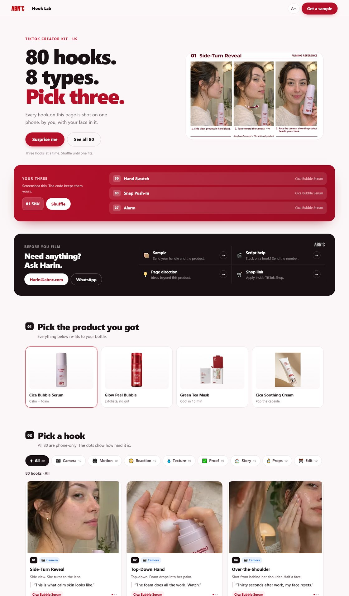

# ABN°C Hook Lab

A one-page hook library for ABN°C TikTok creators (US market).

**80 visual hooks · 8 types · 4 products · one phone.**



---

## Structure

```
index.html            the page (markup + styles + scripts + hook copy)
preview.jpg           screenshot for this README
assets/
  hooks/              80 storyboards — one per hook, 16:10, 1100 × 688
    01-side-turn-reveal.webp
    02-top-down-hand.webp
    …
  products/           4 product shots for the "pick your product" step
  abnc-wordmark.jpg   red wordmark, white background
  abnc-wordmark-white.png
  favicon.svg
```

Keep `index.html` and `assets/` side by side — the page references images with relative paths
(`assets/hooks/…`), so it works from GitHub Pages, a subfolder, or a local file.

## What it does

- **Pick the product you got** — the page re-fits to that bottle (names and which hooks still apply).
- **80 hooks, 8 types** — camera, motion, reaction, texture, proof, story, props, edit.
- **"Your three"** — 3 random hooks plus a code, so every creator gets a different combination. The code persists, so they can screenshot it and send it back.
- **Every hook opens a shot recipe** — the full three-panel storyboard, where the phone goes, what to say, which product, how hard it is.
- **Harin is reachable from every card** — sample, script help, page direction, shop link.

## Publish with GitHub Pages

1. Upload `index.html` **and** the `assets` folder (keep the folder structure).
2. **Settings → Pages → Source: Deploy from a branch → `main` / `/ (root)`**.
3. The page appears at `https://<user>.github.io/<repo>/`.

## Swap a storyboard

One image per hook: `assets/hooks/<id>-<slug>.webp` — for example `25-curtain-snap.webp`.

- **16:10**, 1100 × 688 px, WebP or JPEG, white background.
- Keep the file name: the page maps hook ID → file in the `HOOK_IMG` object.
- Replace the file, reload, done.

## Edit the hooks

All 80 hooks live in one array inside `index.html`. Search for `var HOOKS`:

```js
var HOOKS = [
  ["01","A","Side-Turn Reveal","Side view. She turns to the lens.","This is what calm skin looks like.","all",1],
  ...
];
```

| # | Field | Meaning |
|---|-------|---------|
| 0 | `"01"` | ID — also the image file prefix and the `?hook=01` link |
| 1 | `"A"` | Type: `A` camera · `B` motion · `C` reaction · `D` texture · `E` proof · `F` story · `G` props · `H` edit |
| 2 | title | English hook name |
| 3 | shot | where the phone goes / what happens |
| 4 | line | what the creator says on camera |
| 5 | product | `all`, `serum`, `lumi`, `mask`, `cream`, or `serum+lumi` |
| 6 | difficulty | `1` easy · `2` one prop · `3` needs an edit |

If you change an ID, rename the image to match.

Deep links: `index.html?hook=21` opens that hook, `index.html?cat=A` opens one type.

## Links

- Brand — <https://abnc.com/>
- TikTok Shop — <https://shop.tiktok.com/us/store/abnc-us-store/8656968372695634186>
- Samples, scripts, page direction — **Harin@abnc.com** · WhatsApp **+82 10-3965-7894**
